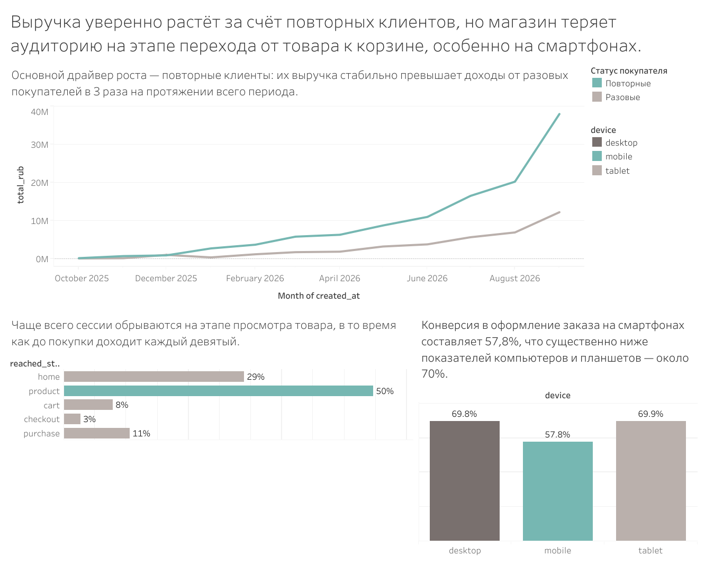

# Продажи интернет-магазина: динамика выручки и воронка визитов

## О проекте
Интерактивный дашборд, разработанный в Tableau для комплексного анализа продаж интернет-магазина. Дашборд позволяет оценить общую динамику выручки, понять, какие клиенты приносят основной доход, а также выявить узкие места в воронке продаж с разбивкой по типам устройств.

## Ссылка на интерактивный дашборд
Вы можете посмотреть и покликать графики прямо в браузере: 
**[Открыть дашборд в Tableau Public](https://public.tableau.com/views/-_17938890814560/sheet6)**

## Превью дашборда

## Бизнес-вопросы, на которые отвечает дашборд
1. **Динамика выручки:** Что происходит с выручкой: она растёт или падает?
2. **Структура выручки:** За счёт кого растёт выручка — разовых или повторных покупателей?
3. **Воронка и устройства:** На каком шаге воронки визиты останавливаются чаще всего, и одинаково ли это на разных устройствах?

## Ключевые выводы (Insights)
*   **Драйвер роста:** Основной драйвер роста — повторные клиенты. Их выручка стабильно превышает доходы от разовых покупателей в 3 раза на протяжении всего периода.
*   **Узкое место воронки:** Чаще всего сессии обрываются на этапе просмотра товара, в то время как до покупки доходит лишь каждый девятый.
*   **Проблема мобильных устройств:** Конверсия в оформление заказа на смартфонах составляет 57,8%, что существенно ниже показателей компьютеров и планшетов — около 70%. Магазин теряет аудиторию на этапе перехода от товара к корзине, особенно на смартфонах.

## Инструменты и методы
*   **Инструмент визуализации:** Tableau
*   **Работа с данными:** 
    *   LOD-выражения (Level of Detail) для разделения клиентов на разовых и повторных.
    *   Построение воронки на основе агрегированных счетчиков датасета с расчетом доли каждого этапа от общего числа визитов.
    *   Вычисляемые поля для расчета и сравнения конверсии между шагами в разрезе типов устройств (desktop, mobile, tablet).

## Структура репозитория
*   `data/` — исходные датасеты (CSV)
*   `dashboard/` — файл дашборда Tableau (.twbx)
*   `images/` — скриншоты для документации

## Как посмотреть проект
1. Перейдите по **[ссылке на Tableau Public](https://public.tableau.com/views/-_17938890814560/sheet6)**, чтобы посмотреть интерактивную версию в браузере (доступно без регистрации).
2. Либо скачайте файл `.twbx` из папки `dashboard` и откройте его с помощью программы [Tableau Public](https://public.tableau.com/ru-ru/s/) (бесплатная версия) или Tableau Desktop.
